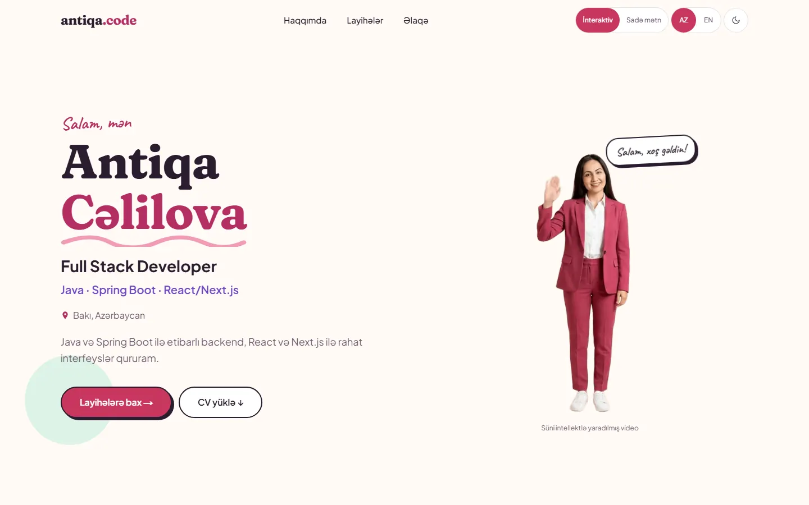
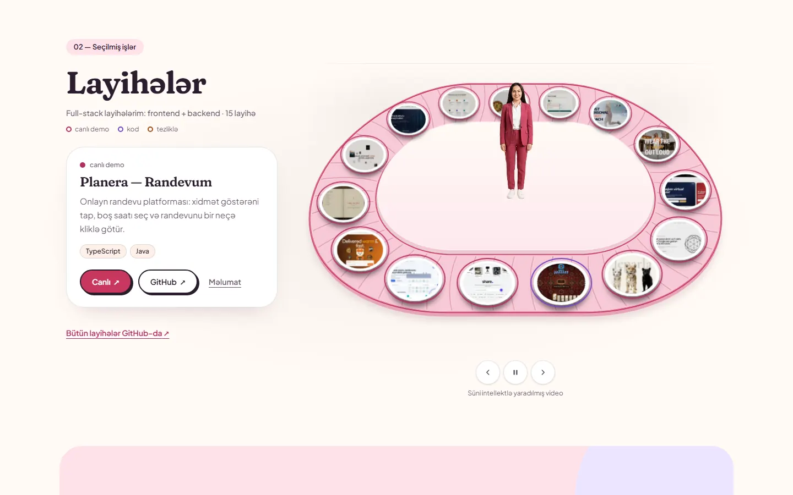
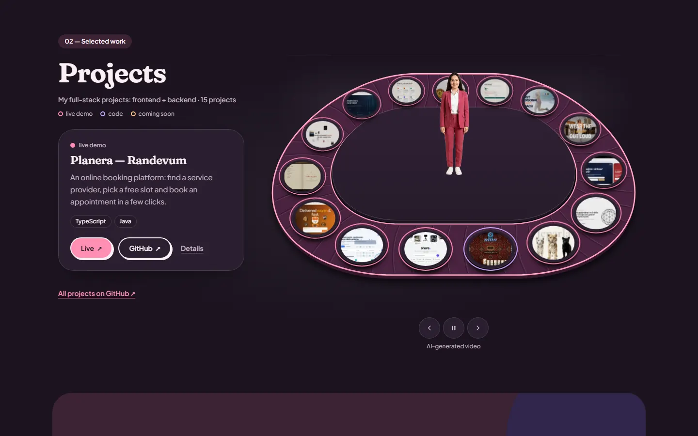
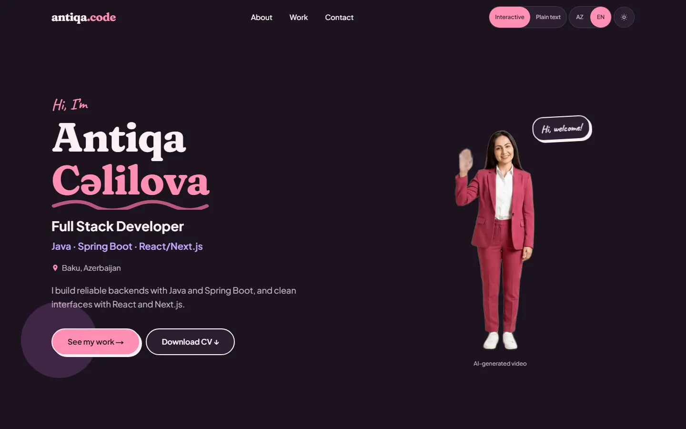
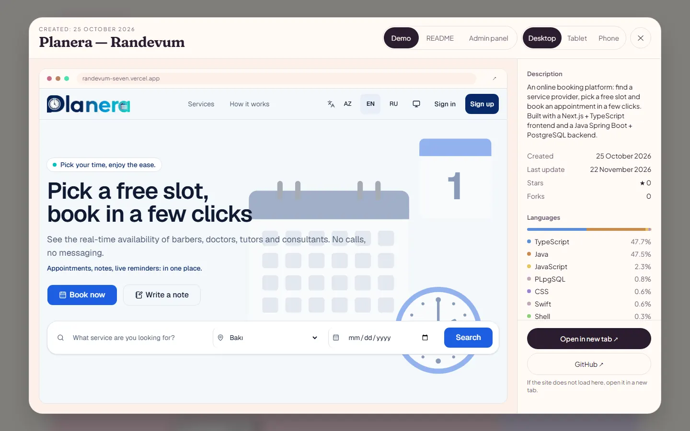
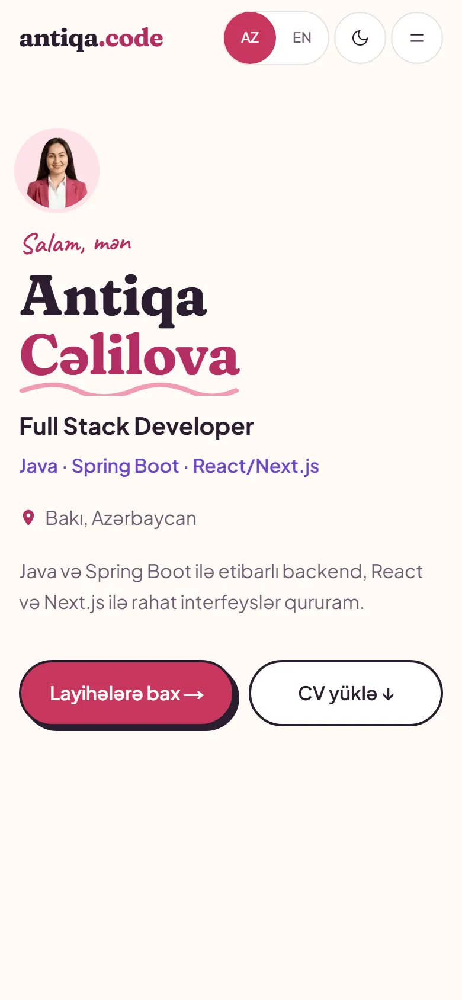
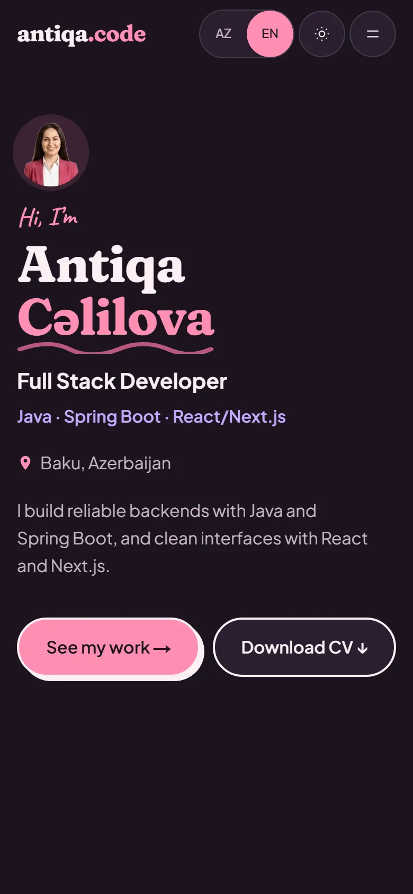
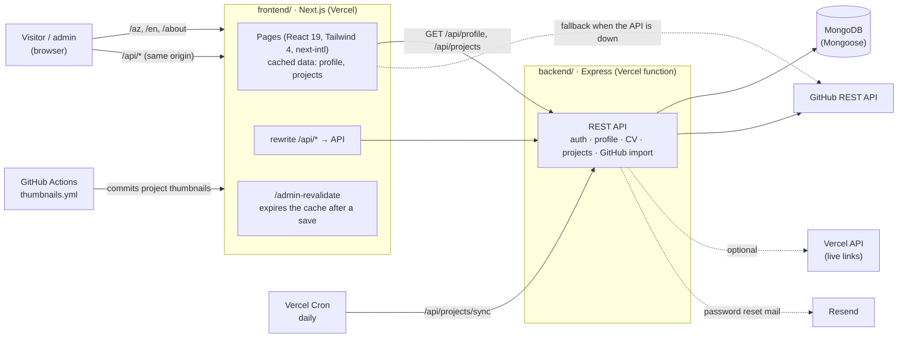

# antiqa.code — Antiqa Cəlilova's portfolio

> **AZ:** Full Stack Developer Antiqa Cəlilovanın portfolio saytı: Next.js + Express + MongoDB, AZ/EN, işıqlı/qaranlıq tema.

Bilingual (Azerbaijani / English) full-stack developer portfolio with an interactive project belt, live demo previews
and a private admin panel that imports projects straight from GitHub.

**Live:** https://antiqa-portfolio.vercel.app



## Screenshots

| Light · AZ | Dark · EN |
| --- | --- |
|  |  |
|  |  |

| Project modal (live demo, README, details) | Mobile 390 px · light AZ | Mobile 390 px · dark EN |
| --- | --- | --- |
|  |  |  |

Screenshots are taken from the live site with Playwright.

## Features

**Site**
- Azerbaijani and English (`/az`, `/en`) with [next-intl](https://next-intl.dev); light and dark theme (next-themes).
- Hero, About (skills, stats, experience), Projects and Contact sections; each has a short AI-generated video
  of the owner (labelled as such on the page). Phones and tablets get a plain one-column layout without videos.
- **Project belt** — the projects ride a conveyor; each card shows live demo / code / coming soon status,
  languages and links.
- **Project modal** — the live demo embedded in a frame (desktop / tablet / phone widths), the repo README
  (Mermaid diagrams included) and, for projects that have one, their admin panel; plus created / updated dates,
  stars, forks and a language breakdown.
- **Plain-text view** (`/about`) with the same facts as the home page and an FAQ.
- Downloadable CV (AZ / EN) managed from the admin panel.

**SEO / GEO**
- `sitemap.xml` with `az` / `en` / `x-default` alternates, `robots.txt` (AI crawlers allowed, admin and API disallowed).
- schema.org JSON-LD (Person, WebSite, ProfilePage, projects as SoftwareSourceCode), generated Open Graph image, `llms.txt` and `llms-full.txt`.

**Admin panel** (`/az/admin`, not linked from the site, `noindex`) — see [docs/ADMIN.md](docs/ADMIN.md)
- Add a project from GitHub: pick from your repos or paste a link; title, description, languages, stars,
  dates and the live link are read automatically (repo homepage → linked Vercel project → `<repo>.vercel.app`
  → GitHub Pages). Private repos can be shown without a code link.
- Per project: featured, hidden, coming soon, "demo is broken — show as code only", AZ/EN texts, order, delete;
  "Refresh all from GitHub".
- CV upload (PDF, AZ and EN), profile / experience / education / skills / contacts editor.
- Sign-in with email + password, "Forgot password?" by e-mail (one-time link, 30 minutes); a reset signs out
  every device.

**Data freshness**
- A Vercel Cron job calls `/api/projects/sync` daily (04:00 UTC) to refresh stars, languages and dates from GitHub.
- A GitHub Actions workflow ([`thumbnails.yml`](.github/workflows/thumbnails.yml), [`tools/thumbs`](tools/thumbs))
  re-captures the project thumbnails from the live sites daily and commits only the ones that really changed.
- If the API is down, the site falls back to GitHub and a built-in seed list, so it never renders empty.

## Architecture

Two Vercel projects from one repo: the Next.js site (`frontend/`) and the Express API (`backend/`, one
serverless function). The browser only talks to the site's own origin; Next.js rewrites `/api/*` to the API, so
the admin session cookie stays first-party.



| Part | Stack |
| --- | --- |
| `frontend/` | Next.js 16 (App Router, Cache Components), React 19, TypeScript, Tailwind CSS 4, next-intl, next-themes, Mermaid |
| `backend/` | Node ≥ 20, Express 5, TypeScript, Mongoose 9 / MongoDB, Zod, JWT (httpOnly cookie), bcrypt, Helmet, sanitize-html |
| `tools/thumbs/` | Playwright + sharp thumbnail capture, run by GitHub Actions |

**API endpoints** (`backend/src/app.ts`): `GET /api/health`; `POST /api/auth/login | logout`, `GET /api/auth/me`,
`POST /api/auth/reset/request | verify | confirm`; `GET|PUT /api/profile`; `GET|PUT /api/cv/:lang`;
`GET|POST /api/projects`, `PATCH|DELETE /api/projects/:id`, `GET /api/projects/:owner/:name/readme`,
`GET|POST /api/projects/sync`; `GET /api/github/repos`, `GET /api/github/preview` (admin only).

**Security notes:** admin session in an httpOnly JWT cookie, failed-login limiter stored in MongoDB,
state-changing requests must be JSON (CV upload excepted), request body limit 100 kB, Helmet headers,
README HTML sanitized; the site's cache-revalidate secret is compared in constant time.

## Run locally

Requirements: Node.js 20+ and npm; MongoDB (local or Atlas) only if you run the API.

```bash
git clone https://github.com/codelady-ship/antiqa-portfolio.git
cd antiqa-portfolio
```

**API** (`backend/`, port 4000):

```bash
cd backend
npm install
cp .env.example .env              # fill in the values (names below)
npm run hash-password -- "your password"   # paste the output into ADMIN_PASSWORD_HASH
npm run dev                       # http://localhost:4000/api/health
```

**Site** (`frontend/`, port 3000):

```bash
cd frontend
npm install
# optional: point the site at the local API (otherwise it uses GitHub + the built-in seed data)
echo "API_URL=http://localhost:4000" > .env.local
npm run dev                       # http://localhost:3000/az
```

Production builds: `npm run build` in each folder (`next build` / `tsc`).

## Tests

```bash
cd backend  && npm test && npx tsc --noEmit   # Vitest + Supertest: API, auth, password reset, limiter, GitHub/live-link services
cd frontend && npm run lint && npm test    # ESLint + Vitest (profile merge)
cd tools/thumbs && npm ci && npm test         # node:test for the thumbnail tool
```

`backend/src/auth.mongo.test.ts` runs against a real MongoDB only when `MONGO_TEST_URI` points to a **local**
throw-away server; otherwise it is skipped.

## Environment variables

Names only — values live in Vercel → Project → Settings → Environment Variables (or a local `.env`, which is git-ignored).
Details: [docs/ADMIN.md](docs/ADMIN.md) and [backend/.env.example](backend/.env.example).

**API (`backend/`)**

| Name | Required | Purpose |
| --- | --- | --- |
| `MONGODB_URI` | yes | MongoDB connection string |
| `JWT_SECRET` | yes | signs the admin session (≥ 32 characters) |
| `ADMIN_EMAIL` | yes | admin sign-in and reset-mail address |
| `ADMIN_PASSWORD_HASH` | yes | bcrypt hash of the initial admin password (`npm run hash-password`) |
| `GITHUB_TOKEN` | recommended | read access to repos (higher rate limit, private repos) |
| `GITHUB_OWNER` | no | GitHub user to list repos for |
| `VERCEL_TOKEN`, `VERCEL_TEAM_ID` | no | find a repo's Vercel live link |
| `RESEND_API_KEY` | for password reset | sends the "Forgot password?" mail |
| `MAIL_FROM` | no | sender address once a domain is verified |
| `SITE_URL` | no | site address used in the reset link |
| `CRON_SECRET` | recommended | bearer token for the daily sync (Vercel Cron) |
| `PORT` | no | local port (default 4000) |

**Site (`frontend/`)**

| Name | Required | Purpose |
| --- | --- | --- |
| `API_URL` | for the API/admin | base URL of the API; enables the `/api/*` rewrite |
| `NEXT_PUBLIC_SITE_URL` | recommended | canonical site URL for metadata, sitemap and JSON-LD |
| `CRON_SECRET` | no | lets scripts expire the cache via `/admin-revalidate` |
| `GITHUB_TOKEN` | no | higher GitHub rate limit for the fallback data |
| `GOOGLE_SITE_VERIFICATION` | no | Google Search Console verification tag |

## Project structure

```
frontend/   Next.js site — src/app (routes, sitemap, robots, llms.txt, OG image), src/components, messages/{az,en}.json
backend/    Express API — src/app.ts (routes), src/auth.ts, src/reset.ts, src/services (GitHub, live links), api/index.ts (Vercel entry), scripts/
tools/      thumbs — Playwright thumbnail capture for the project belt
docs/       ADMIN.md (admin guide), PLAN.md, screenshots/
```

## Contact

- Site: https://antiqa-portfolio.vercel.app
- GitHub: [@codelady-ship](https://github.com/codelady-ship)
